---
# Try harder and write more docs better
and eat your greens

---
# Working with the garage door up

---
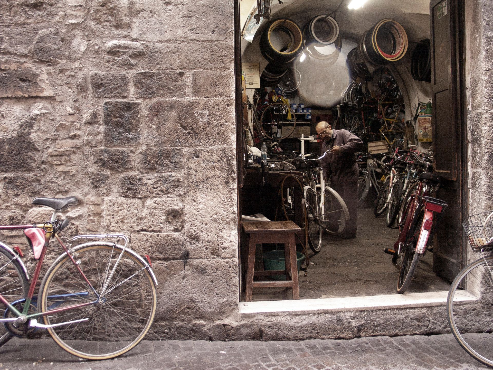
<!-- image credit: Roman Biernacki https://images.pexels.com/photos/18700799/pexels-photo-18700799.jpeg -->

---
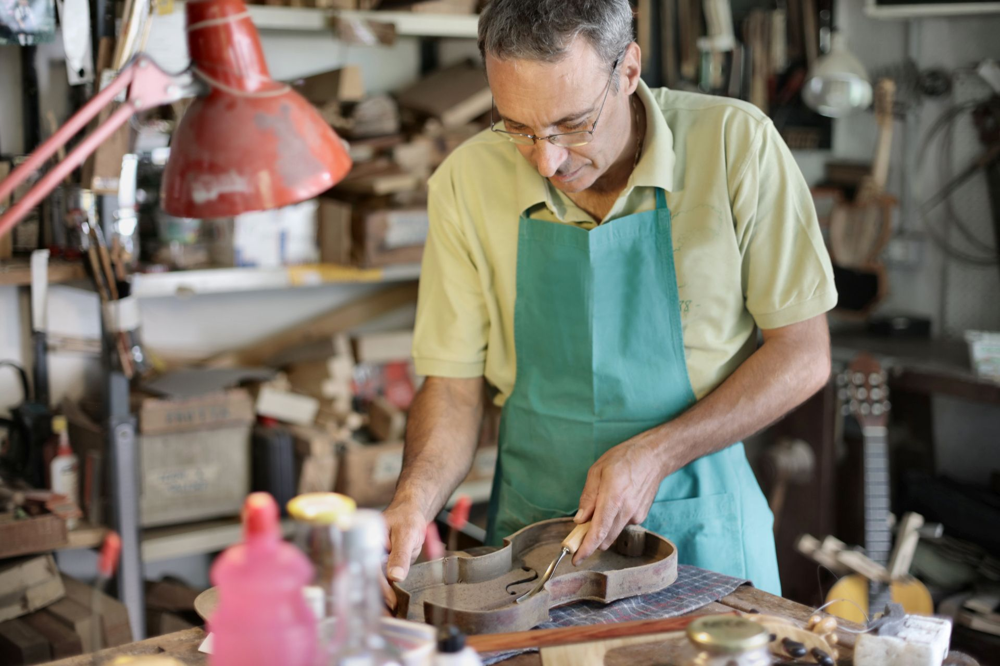
<!-- image credit: Andrea Piacquadio https://images.pexels.com/photos/3853200/pexels-photo-3853200.jpeg -->

---
Working with the garage door up means...
 
- show your working
- don't wait until it's publishable
- let people stumble upon your notebook
 
...and keep aiming that at people, even in the age of AI

---

Slides + links, if you want to follow along or choose your own adventure 👉

---
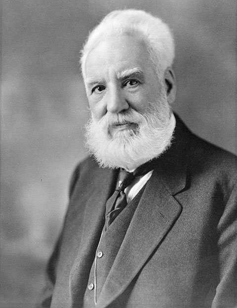
<!-- Photo Moffett Studio - Library and Archives Canada / C-017335 https://commons.wikimedia.org/w/index.php?curid=1559 -->
---

---
<!-- header: Bell: Keep your working -->

---
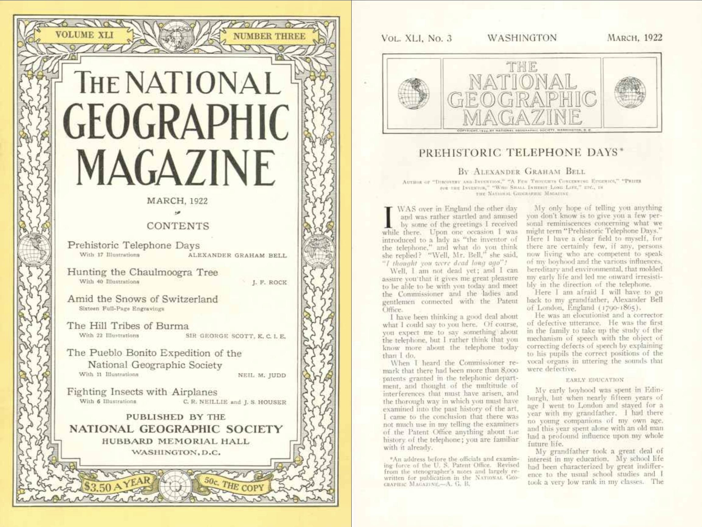
<!-- National Geographic March 1922 -->

---
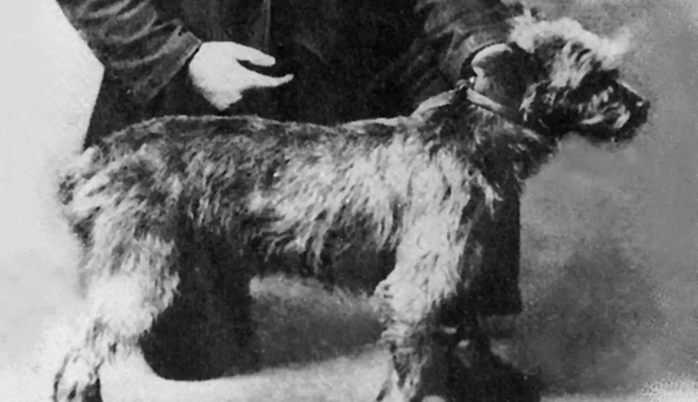
_"How do you do, Grandmama?"_

---
Developed at
Bell Telephone Company → AT&T → Bell Labs...
 
- Transistor
- Negative feedback amplifier
- Electret condenser microphone
- Nyquist/Shannon
- FFT
- Unix, C, C++

---
# Ear Phonautograph

---

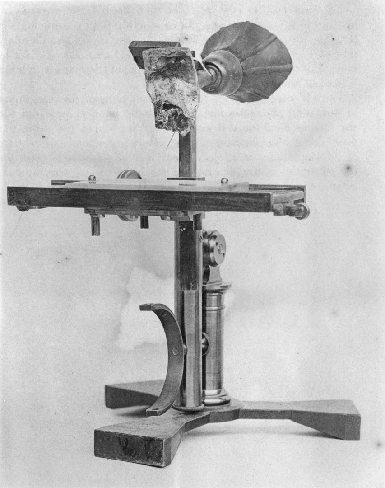
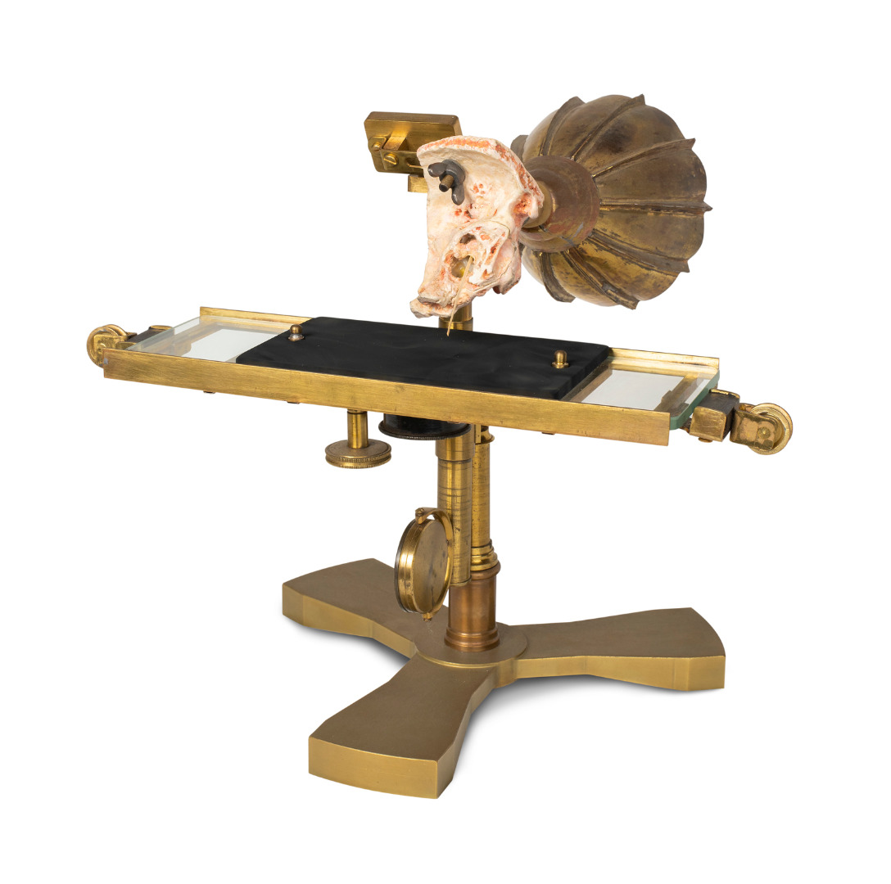
<!-- https://journal.sciencemuseum.ac.uk/article/writing-sound/ -->

---
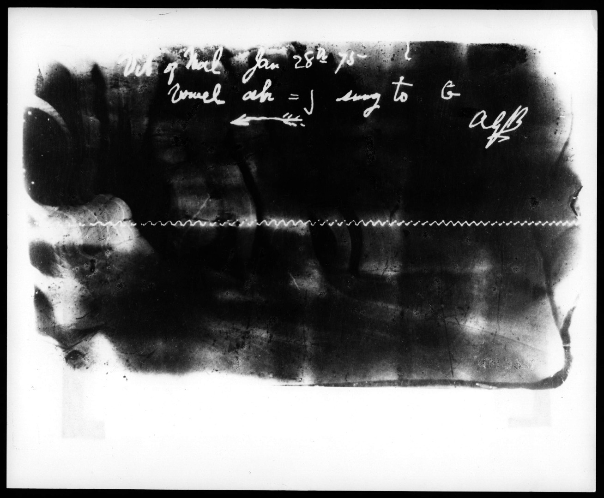
<!-- https://journal.sciencemuseum.ac.uk/article/writing-sound/ -->

---
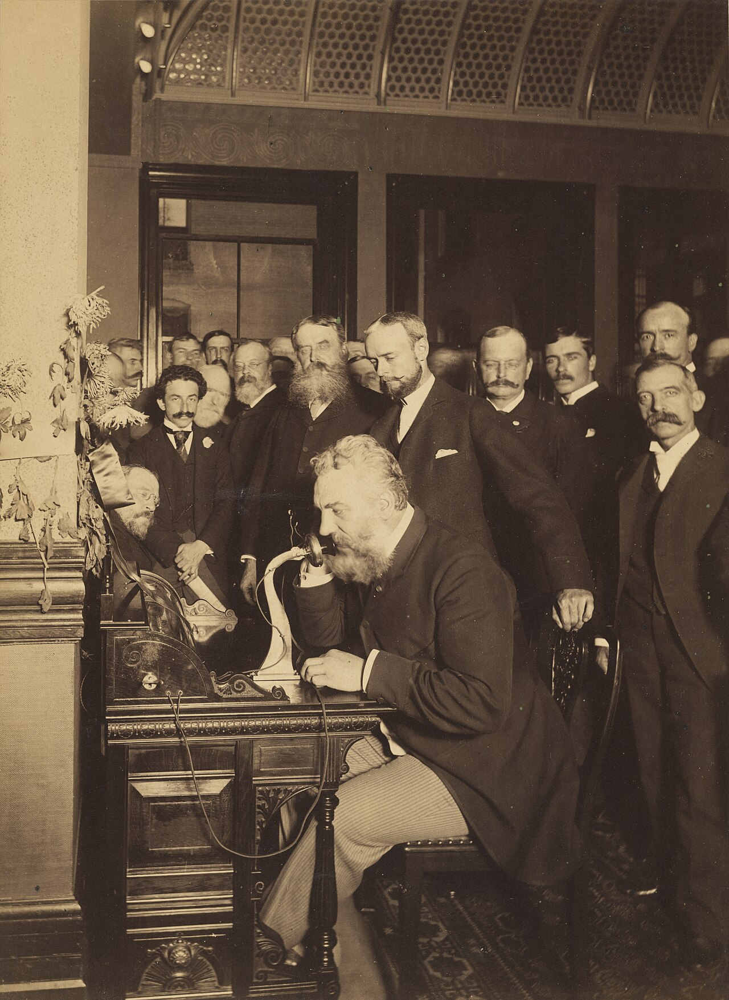
<!-- Photo E. J. Holmes - National Portrait Gallery https://commons.wikimedia.org/w/index.php?curid=180916407 -->

---

> Today’s rabbit hole is tomorrow’s shortcut.

<!-- _footer: — probably Confucius -->

---
<!-- header: 3M: Share your working -->

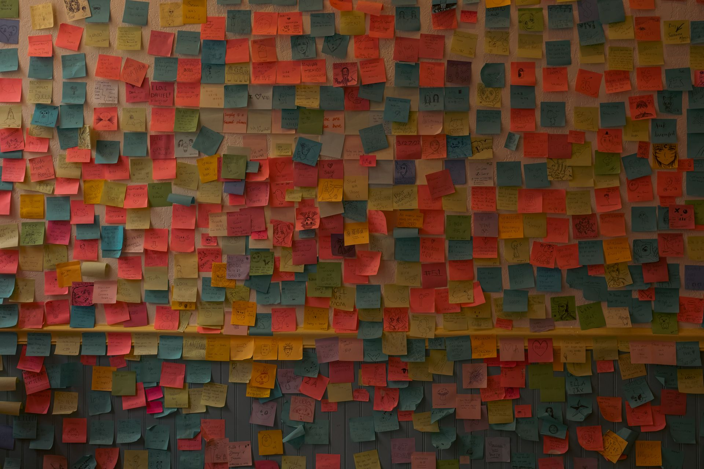
<!-- image credit: Connor Scott McManus https://www.pexels.com/photo/sticking-notes-on-the-wall-12797275 -->

---
> It was part of my job as a researcher to develop new adhesives, and at that time we wanted to develop bigger, stronger, tougher adhesives. This was none of those.

<!-- _footer: — Dr Spencer Silver, 3M -->

---
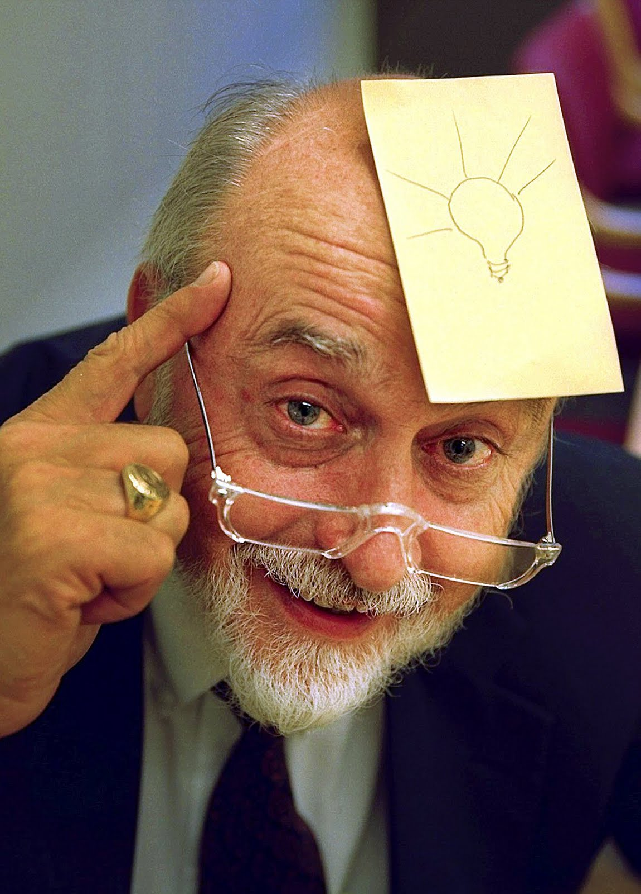
<!-- image Signe Dons https://commons.wikimedia.org/w/index.php?curid=6277669 -->

---
> Hide not thy half-finished work under a bushel, for thou knowest not who hath need of it.
<!-- _footer: — Adhesions 3:16 -->

---
<!-- header: "" -->
# Delia Derbyshire

_"Coventry born, bred, and blitzed"_

---
<!-- header: Delia Derbyshire: Frame your working in context -->
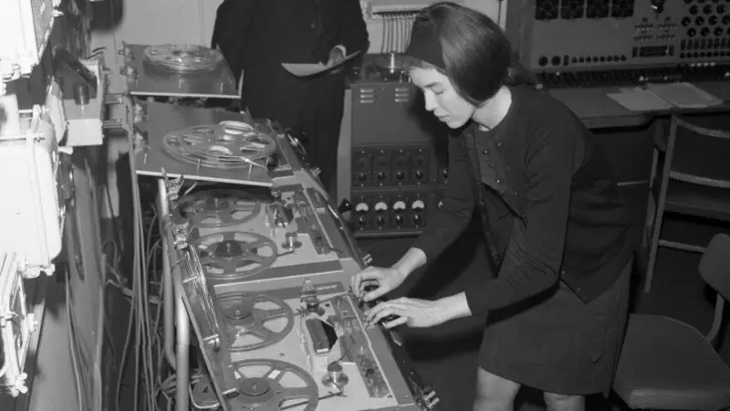
<!-- image BBC https://www.bbc.co.uk/news/articles/cd19y3gj7x2o -->

---
_"Did I really write that?"_

_"...most of it"_

---
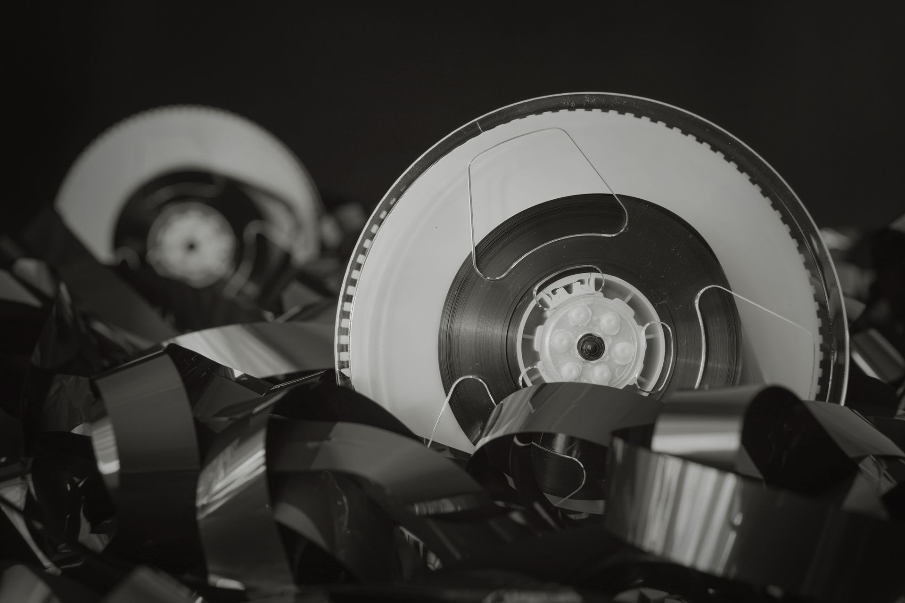
<!-- image credit: Dmitry Demidov https://images.pexels.com/photos/6764886/pexels-photo-6764886.jpeg -->

---
<!-- _class: [invert, banners] -->
⚠️ Early idea, not ready to recommend this yet, we're hoping to give it a try on project xyz

 

❌ We tried this, it didn't work out because xyz

 

⏭️ Superceded since BestSystem2 went live, go there for new projects instead

---
> He who labels not his reels shall be catalogued by strangers.
<!-- _footer: — Mancunian proverb -->

---
<!-- header: "" -->
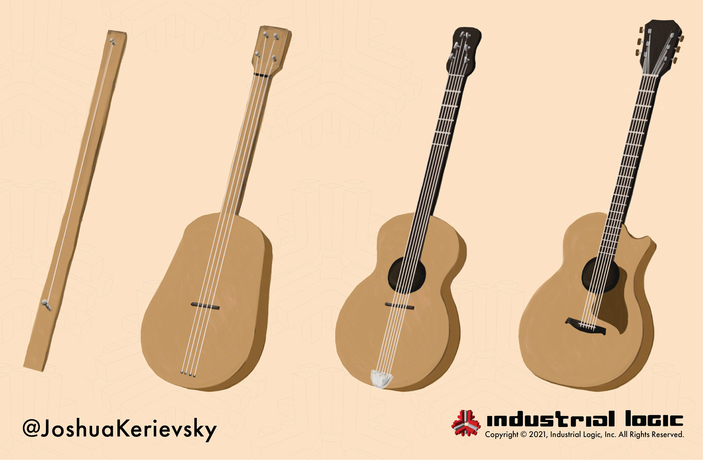
<!-- image credit: Joshua Kerievsky https://www.industriallogic.com/blog/evolutionary-design/ -->

---
<!-- header: and AI? -->
# Opening the garage door for agents

- Editing AGENTS.md is dead easy
- Low expectations of writing quality
- Immediate payoff

---
Don't throw your notes up in the loft

<!-- image credit: Jeswin Thomas https://www.pexels.com/photo/fir-tree-decor-1628417/ -->

---
# Opening the garage door for ~~agents~~ everyone

- **Keep it**: Write for yourself first
- **Share it**: Make it visible to people and agents
- **Frame it**: Signpost where to find it _and_ what it means

---
# 👃
Look out for these smells / red flags...
 
- The first place something gets recorded is an agent file
- AGENTS.md is longer than README.md
- Rules say _always_ and _never_ more than _because_
- Lots of duplication between agent files

---
<!-- Blank while begin conclusion -->
<!-- header: "" -->

---
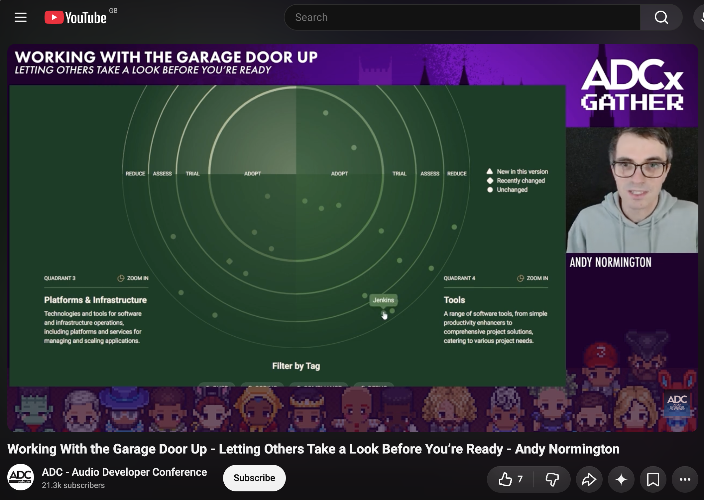

---
<!-- Blank -->

---
# Slides and links
[GitHub: andyn-ff/adc-2026-show-your-working](https://github.com/andyn-ff/adc-2026-show-your-working)
 

---
- [Related ADCx Gather 2025 talk notes](https://github.com/andyn-ff/adcx-gather-2025)
- [Robin Sloane / Andy Matuschak](https://notes.andymatuschak.org/About_these_notes?stackedNotes=z21cgR9K3UcQ5a7yPsj2RUim3oM2TzdBByZu)
- [Alexander Graham Bell: Prehistoric Telephone Days (National Geographic March 1922)](https://avalonlibrary.net/National_Geographic/National%20Geographic%201922-03%20041-3%20Mar.pdf)
- Bell's Ear Phonautograph + reconstruction: [Science Museum Journal](https://journal.sciencemuseum.ac.uk/article/writing-sound/), [Ingenium Canada](https://ingeniumcanada.org/channel/articles/reconstructing-a-lost-object-can-you-identify-this-component-in-alexander-graham)
- [3M's Post-it development](https://www.post-it.com/3M/en_US/post-it/contact-us/about-us/)
- [Delia Derbyshire archive](https://deliaderbyshireday.com/dd-archive/)
- [Clare Sudbery: Let's stop making each other feel stupid](https://insimpleterms.blog/lets-stop-making-each-other-feel-stupid)
- [`just` command runner](https://just.systems)
- [Tech radar talk at LeadDev 2024: Andra Blaj](https://leaddev.com/technical-direction/how-to-use-technology-radars-to-make-transparent-tech-decisions)
